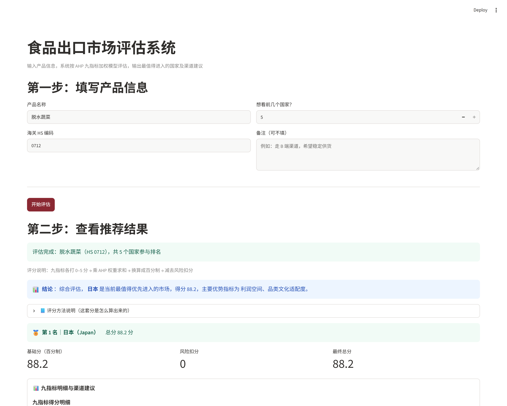
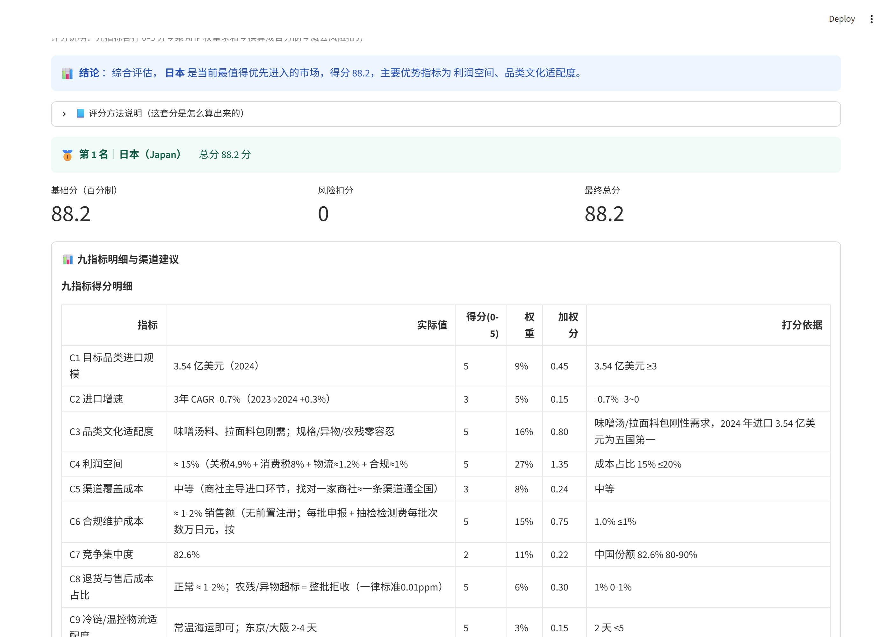
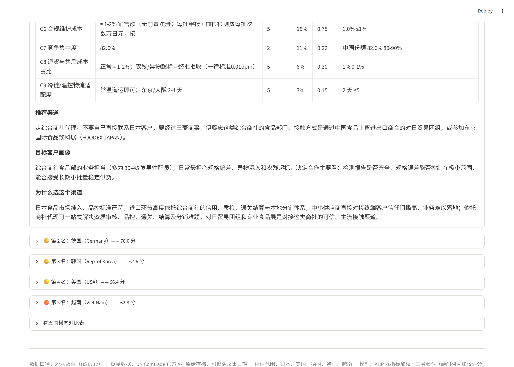

# 食启远航 · 食品出口市场评估决策支持系统（V1）

> 输入一个食品产品，输出「优先进入哪个国家 + 走什么渠道 + 找什么样的客户」。
> 大学生创新创业训练计划（ZJSRTP）立项项目 · 5 人跨专业团队 · 本人任项目负责人


---

## 一、这个系统解决什么问题

江苏有大量中小食品加工企业想做出口，但普遍卡在第一步：**不知道该先打哪个国家**。
市面上的信息要么是宏观行业报告（离"我这个品能不能卖"太远），要么是货代和展会中介的经验之谈（无法复核）。

本系统把"选市场"这件事拆成可计算、可追溯的流程：企业填一个产品，系统按 **AHP 九维加权 + 三层漏斗评分模型** 对候选国排名，并给出该国的进入渠道与目标客户画像。

**系统做什么（V1 已实现）**
- 按九项指标对候选国打分、加权、排名，输出 Top 5 与逐项得分依据
- 输出每个推荐国家的进入渠道、目标客户画像、选择理由
- 输出风险扣分项（关税 / 认证成本 / 汇率波动）与硬门槛淘汰原因

**系统不做什么（有意为之的边界）**
- ❌ 不做交易撮合、不做买家对接 —— 只做**决策支持**，不介入成交
- ❌ V1 不使用机器学习 —— 9 个维度、5 个国家的样本量喂不动机器学习，加权评分可解释、可复核、可在答辩现场被追问每一个分数
- ❌ V1 不含爬虫 —— 数据靠官方 API 与人工核验，保证每个数字能追溯来源

> 当前版本覆盖 **脱水蔬菜（HS 0712）× 5 个候选国**（日本、美国、德国、韩国、越南）。
> 单品类单批次是为把方法论跑通、跑对；模型本身与品类无关，扩品类是加数据，不是改逻辑。

---

## 二、实测输出

`python scoring.py --detail` 的真实输出（数据见 `country_metrics.csv`）：

| 排名 | 国家 | 基础分（百分制） | 风险扣分 | 总分 |
|:--:|:--|--:|--:|--:|
| 🥇 1 | 日本 | 88.2 | 0 | **88.2** |
| 2 | 德国 | 72.0 | −2 | 70.0 |
| 3 | 韩国 | 67.6 | 0 | 67.6 |
| 4 | 美国 | 71.4 | −5 | 66.4 |
| 5 | 越南 | 64.8 | −2 | 62.8 |

日本九项明细（其余国家见 `python scoring.py --detail`）：

```
C1 目标品类进口规模   5 分 × 9%  = 0.450   3.54 亿美元（五国第一）
C2 进口增速          3 分 × 5%  = 0.150   3 年 CAGR −0.7%
C3 品类文化适配度      5 分 × 16% = 0.800   味噌汤料、拉面料包刚性需求
C4 利润空间          5 分 × 27% = 1.350   总成本占货值 ≈15%（关税 4.9% + 消费税 8%）
C5 渠道覆盖成本       3 分 × 8%  = 0.240   商社主导，找对一家商社≈一条渠道通全国
C6 合规维护成本       5 分 × 15% = 0.750   ≈1% 销售额，无前置注册
C7 竞争集中度        2 分 × 11% = 0.220   中国份额 82.6%（市场已被中国货占满）
C8 退货与售后成本     5 分 × 6%  = 0.300   ≈1%
C9 物流适配度        5 分 × 3%  = 0.150   2 天（五国最快之一）
────────────────────────────────────────
基础分 4.410 → ×20 → 88.2 分
```

**结论怎么读（这点必须说明）**：分差 5 分以内应视为"同一梯队"，不是严格优劣。
第 3、4 名（韩国 67.6 / 美国 66.4）仅差 1.2 分，在部分权重方案下会换位；
而日本的领先（18 分以上）在 8 组权重扰动测试下全部保持第一。

---

## 三、界面



九项指标的得分、权重、加权分与打分依据逐项列出，任何一个分数都能倒退回原始数据：



第 1 名直接给出渠道、客户画像与选择理由；2–5 名折叠展示：



---

## 四、方法：三层漏斗

```
候选国
  │
  ├─ 第一层  硬门槛过滤 ──────────  命中即淘汰，不进打分
  │           法规不可准入 / 宗教合规冲突 / 保质期余量不足
  │           （本批五国均通过，规则保留备查）
  │
  ├─ 第二层  九维加权评分 ────────  每项打 0–5 分 × AHP 权重
  │           Σ(得分 × 权重) = 基础分（5 分制）→ ×20 = 百分制
  │
  └─ 第三层  风险扣分 ───────────  独立于加权，命中才扣
              对华加征关税 −5 / 认证费超毛利 5% −2 / 汇率年波幅 >10% −2
  │
  ▼
总分 = 基础分 × 20 − 风险扣分
```

**九维指标与 AHP 权重**（权重经成对比较 + 一致性检验 CR < 0.1 后冻结，不随国家变化）：

| 编号 | 维度 | 权重 | 数据来源 |
|:--:|:--|--:|:--|
| C4 | 利润空间 | 27% | 关税 + VAT/消费税 + 物流 + 合规成本测算 |
| C3 | 品类文化适配度 | 16% | 饮食结构定性分析（人工定分，见下） |
| C6 | 合规维护成本 | 15% | 准入法规 + 认证费 + 抽检摊薄 |
| C7 | 竞争集中度 | 11% | 中国货占该国该品类进口份额（反向指标：份额越低机会越大） |
| C1 | 目标品类进口规模 | 9% | UN Comtrade 进口额 |
| C5 | 渠道覆盖成本 | 8% | 零售/批发集中度 CR4 |
| C8 | 退货与售后成本占比 | 6% | 品控事故概率 × 单批损失 |
| C2 | 进口增速 | 5% | 3 年 CAGR |
| C9 | 冷链/温控物流适配度 | 3% | 在途天数 + 运价 |

**两个刻意的设计决定**（也是踩过坑之后改的）：

1. **C3 改为人工定分。** 原始数据是给人读的描述文本，程序靠关键词判断会把"偏好可追溯供应链"误读成负面。五国各定一个分数，理由可讲、可复核，程序不再猜关键词。
2. **区间型数据统一取区间下限。** 下限代表正常水平成本；上界是极端情况，而极端情况已由第三层风险扣分单独惩罚，不重复计算。

---

## 五、目录结构

```
food-voyage/
├── README.md                 # 本文件
├── app.py                    # Streamlit 界面（输入 → 结果卡片）
├── scoring.py                # 评分引擎：三层漏斗主体
├── build_db.py               # CSV → SQLite 一键建库（纯标准库）
├── db.py                     # 表结构定义
├── import_excel.py           # Excel → SQLite（组内协作流程）
├── fetch_data.py             # UN Comtrade 官方 API 抓取
├── requirements.txt          # 依赖
├── country_metrics.csv       # 五国 × 九指标数值（核心数据表）
├── weights.csv               # 九维权重与打分规则
├── channels.csv              # 五国渠道与客户画像
├── 01-评分模型说明.md         # 九维定义、打分档位、风险规则
├── 02-数据来源与口径.md       # 每个数字的来源、区间取法、合规依据
├── 03-项目推进与分工.md       # 里程碑、任务拆分、踩坑与回归清单
├── ui-overview.png           # 界面截图：总览
├── ui-metrics.png            # 界面截图：九指标明细
├── ui-channels.png           # 界面截图：渠道建议
├── Germany_0712_2024_*.json  # 5 份原始 API 返回样例（带抓取时间戳）
└── .gitignore
```

> 小项目采用平铺结构，代码、数据、文档、截图都在同一层，点开即看。
> 数据以 CSV 形式入库而不是 Excel：CSV 能 diff、能直接在仓库里审阅，
> 也避免二进制文件在版本管理里变成「黑盒」。团队内部的 Excel 源文件仍在本地维护。

> 数据以 CSV 形式入库而不是 Excel：CSV 能 diff、能直接在这里审阅，
> 也避免二进制文件在版本管理里变成"黑盒"。团队内部的 Excel 源文件仍在本地维护。

---

## 六、运行

```bash
pip install -r requirements.txt

python build_db.py           # 从根目录 *.csv 建库（几秒，纯标准库）
python scoring.py            # 五国排名
python scoring.py --detail   # 每个国家九项各得几分、依据是什么
streamlit run app.py         # 打开网页界面（数据库缺失时会自动构建）
```

抓取最新贸易数据（需在 [UN Comtrade](https://comtradeapi.un.org) 申请免费 key，写入 `config.ini` 或环境变量 `COMTRADE_KEY`）：

```bash
python fetch_data.py     # 原始 JSON 存入 data/raw/，汇总存 comtrade_summary.csv
```

---

## 七、数据来源与可追溯性

| 类别 | 来源 | 说明 |
|:--|:--|:--|
| 贸易规模 | UN Comtrade 官方 API | HS 0712，2022–2024 三年；原始 JSON 带抓取时间戳存档 |
| 关税 / 税制 | 中国海关税则注释、USITC HTS、EU CN 注释 | 不用二手整理稿 |
| 准入与认证 | 目的国官方主管机构（FDA / MHLW / MFDS / EU CHED-D 等） | 逐条对应国家 |
| 渠道结构 | 各国零售/批发集中度公开资料 | 用于 C5 档位判定 |

- 越南 2024 年未上报，采用 2023 年数据并在数据表中标注年份 —— **不插值、不推测**。
- 仓库根目录保留每国 1 份原始 API 返回作为样例；完整 70 份（2022–2024 × 5 国 × 全球/中国两种口径）留存在本地存档目录，可按需提供。

---

## 八、我在项目中的角色

项目负责人（组长），5 人跨专业团队（软件工程 × 2、国际经济与贸易 × 2、工业工程 × 1）。我主要负责：

- **需求与边界收敛**：把最初"帮企业找买家"的模糊设想收敛为"市场评估决策支持"，并明确 V1 只做 1 品类 × 5 国、不上机器学习、不做撮合 —— 边界清晰才做得完。
- **评分口径裁定**：区间型数据统一取下限、C3 改人工定分、C7 反向指标符号统一。每一次口径变更都落成书面说明发回给国贸组，避免"同一张表三个人算出三个数"。
- **数据管道与验收**：Comtrade 抓取脚本 → Excel → SQLite → 评分引擎，全链路跑通；用逐格交叉核对的方式，把程序输出与国贸手算表对到每一格，不一致就回头查分档规则。
- **迭代管理**：任务书按周拆分到人、每周节点验收、问题回归清单；界面、评分引擎、数据表三方改动互相牵制时，负责判定以哪一方为准。
- **对外沟通**：联系并拜访江苏本土食品出口企业，确认 B 端渠道导向，回收真实的渠道与客户画像输入。

**团队分工**：国贸组负责 AHP 权重与市场数据采集、工业工程负责指标口径交叉校验、软件工程组负责界面与评分引擎实现。

---

## 九、已知局限与下一步

**局限**
- 单品类（HS 0712）单批次验证，跨品类时部分指标（如 C9 物流）需要按温控要求重新定档。
- C3 / C5 / C8 含定性判断成分，已通过"人工定分 + 书面理由"降低随意性，但仍是模型最软的一环。
- 权重一次性冻结，未做动态调整（如按企业规模、产能切换权重）。

**下一步**
- 扩品类：冷冻蔬菜（HS 0710）、调味品（HS 2103），验证模型复用性
- HS 编码归类辅助：输入产品描述推荐 HS 编码，降低企业使用门槛
- 权重情景模式：按"稳利润 / 抢规模 / 低风险"三种企业偏好输出不同排名

---

## 说明

本项目为大学生创新创业训练计划立项项目，代码与文档用于方法展示与团队协作。
评分结果基于公开数据与既定口径，不构成任何贸易决策建议。
